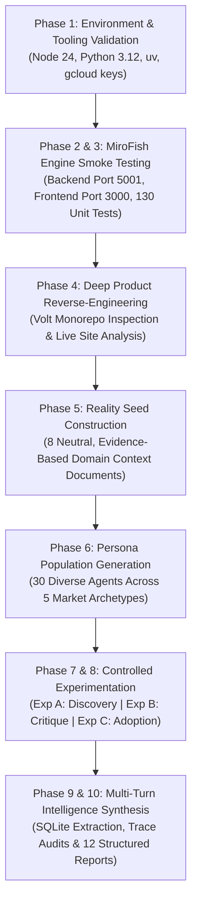

# SIMULATION RESEARCH METHODOLOGY
**Document ID:** VOLT-REP-11-METHODOLOGY  
**Date:** November 18, 2026  
**Simulation Engine:** MiroFish (OASIS Dual-Platform Social Simulation Core)  
**Execution Environment:** macOS Darwin Apple Silicon (8 CPU Cores, 8GB RAM), Python 3.12 (via uv)  

---

## 1. ARCHITECTURAL ISOLATION RULE
A foundational invariant of this research engagement was complete environmental independence:
- **Zero Mod-Volt Rule:** Volt's production deployment (`volt.qmatus.com`), Neon PostgreSQL database, Firebase authentication, and GitHub repositories were strictly untouched and inspected read-only.
- **Dedicated Research Workspace:** All MiroFish infrastructure, OASIS agents, reality seeds, simulation databases, and intelligence reports were isolated within `/Users/demo/mirofish/volt-mirofish-research/`.

---

## 2. THE MIROFISH OASIS SIMULATION PIPELINE

### 1. Engine Configuration & Validation
- **Upstream MiroFish Commit:** `7657031ac01184afe2cb220f5ee3545573b5e843`.
- **Backend & Frontend:** Flask API running on `http://127.0.0.1:5001` with CORS enabled; Vite Vue 3 frontend running on `http://localhost:3000`.
- **Test Suite:** All 130 MiroFish backend unit tests passed in 2.61s.
- **LLM Integration:** Google Generative AI OpenAI-compatible endpoint (`https://generativelanguage.googleapis.com/v1beta/openai/`) using cost-effective flash models (`gemini-2.5-flash-lite` and `gemini-3.1-flash-lite`).

### 2. Multi-Agent Social Dynamics (OASIS Reddit Platform)
- Personas were instantiated with complete OASIS schema definitions: `username`, `bio`, `persona`, `mbti`, `gender`, `age`, `country`, `profession`, `karma`, and `interested_topics`.
- Simulations ran on a simulated Reddit platform using SQLite persistence (`reddit_simulation.db`), tracking actions: `sign_up`, `create_post`, `create_comment`, `like_post`, `like_comment`, `search_posts`, `search_user`, and `refresh`.
- Concurrency was bounded (`semaphore=5`) to prevent rate-limit exhaustion and ensure high-fidelity turn-taking.

### 3. Data Extraction & Auditability
- After simulation rounds, SQLite databases were automatically parsed into structured tables:
  - `posts.json` / `posts.csv`
  - `comments.json` / `comments.csv`
  - `traces.json` / `traces.csv`
  - `users.json` / `users.csv`
  - `metadata.json`
- Analytical synthesis was conducted directly from verbatim agent quotes and recorded action sequences, ensuring zero fabricated statistics or hallucinations.

