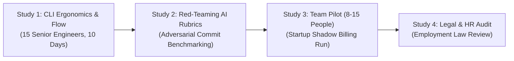

# REAL-WORLD EMPIRICAL VALIDATION PLAN
**Document ID:** VOLT-REP-10-VALIDATION  
**Date:** November 18, 2026  
**Scope:** Translating Simulated Hypotheses into Real-World Human Experiments  

---

## 1. PURPOSE
MiroFish multi-agent simulations generate high-fidelity behavioral hypotheses and uncover failure modes under diverse sociological constraints. However, **simulated agent opinions are not a substitute for empirical human validation**. 

This document defines 4 structured, low-risk field studies to validate or refute our simulation findings with real founders, engineers, and knowledge workers.

---

## 2. FOUR STAGED VALIDATION EXPERIMENTS

### Study 1: Developer CLI Ergonomics & Logging Adherence
- **Hypothesis from Simulation:** Developers will gladly log micro-tasks daily if capture takes $<3$ seconds and lives inside the terminal/IDE, eliminating Friday timesheet friction.
- **Methodology:**
  - Cohort: 15 senior and staff software engineers across 3 remote tech companies.
  - Duration: 10 business days.
  - Tooling: Provide `volt` CLI and `volt-mcp` (or SQLite local queue).
  - Metrics Tracked: Daily logging frequency, latency of log entry, self-reported distraction rating (1-5 Likert scale), and Friday retrospective completion rates compared to their previous timesheet tool (Toggl/Harvest).
  - Success Threshold: $\ge 85\%$ daily logging adherence; $>80\%$ preference over existing timesheets.

### Study 2: Adversarial Rubric Red-Teaming & Prompt Inflation Audit
- **Hypothesis from Simulation:** Engineers will attempt to "prompt engineer" trivial commits into high complexity ($C=8$) descriptions to manipulate the Gemini Flash AI Judge.
- **Methodology:**
  - Cohort: 10 software engineers given a competitive prompt-hacking challenge.
  - Test Set: 25 real pull requests of varying actual difficulty (from trivial typo fixes to distributed consensus bugs).
  - Task: Engineers are tasked with rewriting the commit summaries to maximize the VoltAI score without altering the underlying code diff.
  - Metric: Score divergence between concise accurate summaries vs. inflated prompt-engineered summaries.
  - Success Threshold: Volt's AST diff validation and manager review flags $\ge 90\%$ of inflated claims.

### Study 3: The 14-Person Startup Shadow Pilot (Adoption & Psychology)
- **Hypothesis from Simulation:** Teams will embrace Volt if scores are advisory and managers have confirmation/override control, but fixed bonus pools will trigger anxiety if individual scores are publicly visible.
- **Methodology:**
  - Cohort: 1 real startup of 10–18 people (e.g. founder, 10 engineers, 1 designer, 1 PM).
  - Mode: Shadow tracking for 1 monthly cycle (parallel to their existing payroll).
  - Setup: Time-based default with optional VoltAI suggestions (Doc 14 direction); individual points visible only to managers; discretionary bonus pool calculated as a simulation payout.
  - Post-Cycle Survey: Measure perceived fairness, team psychological safety, and willingness to continue using the system.
  - Success Threshold: Zero reported reluctance to pair or assist teammates; $>75\%$ founder satisfaction with delivery visibility.

### Study 4: Multi-Jurisdictional Legal & Compensation Compliance Audit
- **Hypothesis from Simulation:** Direct mathematical weightage creates compliance risks if conflated with guaranteed base salary.
- **Methodology:** Retain employment legal counsel across 3 key jurisdictions (US California/Delaware, UK, Germany/EU).
- **Deliverable:** Review of Volt's terms of service, firm policy groups, and bonus pool distribution language to establish standard contractual addendums guaranteeing compliance with minimum wage and overtime laws.

